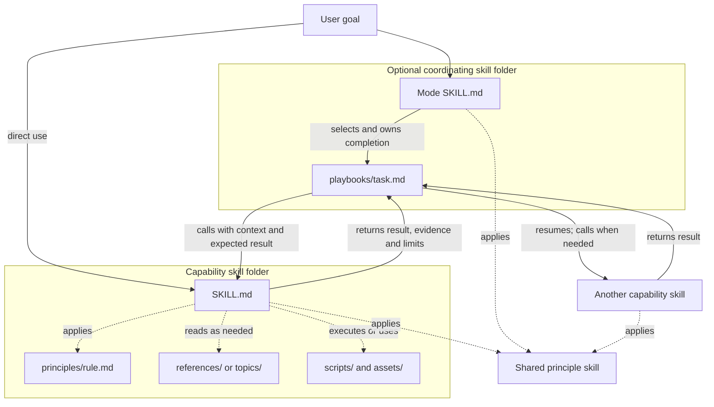

# Overview

Organize by responsibility and scope. A skill owns a capability, a playbook sequences work, and a principle guides a decision. These are authoring roles, not separate platform file types.

## How the pieces fit



Boxes group files by owner. Solid arrows show work and its return to the caller; dotted arrows select guidance or resources. The caller owns the original outcome and resumes after consuming a specialist result. Local principles stay with their owner; shared principles serve several skills. Supporting files are optional and loaded only when needed.

## Repository layout

```text
docs/                           Human-facing library guides
skills/
  <skill>/
    SKILL.md                    Discovery, scope, core guidance, routing
    playbooks/<task>.md          Optional task procedures
    principles/<rule>.md        Optional local decision rules
    references/<detail>.md      Conditional contracts, rubrics, examples
    topics/<subject>.md         Optional subject-based knowledge leaves
    scripts/                    Executable helpers and checks
    assets/                     Templates and files used in output
  principle-<name>/SKILL.md      Shared decision rule
in-progress/                    Drafts awaiting promotion into skills/
```

Create only the directories a skill needs. A short skill can be one `SKILL.md`. Keep generated work and project-specific records in the consuming project.

## Taxonomy

| Role | Use when | Home |
| --- | --- | --- |
| Workflow skill | A reusable job requires a procedure or produces a defined result. | `skills/<name>/SKILL.md` |
| Knowledge/capability skill | Standards and judgment apply within many possible tasks. | `skills/<name>/SKILL.md` |
| Mode skill | Working conventions and routing coordinate several capabilities; Work Mode recovers intent and owns overall completion. | A normal skill, optionally owning playbooks |
| Playbook | One task variant needs a particular sequence; Work Mode owns setup, planning, task creation and execution alongside its other playbooks. | `<skill>/playbooks/<task>.md` |
| Local principle | A durable decision rule depends on one skill's domain or contract. | Inline if short; otherwise `<skill>/principles/<name>.md` |
| Shared principle skill | The same durable judgment applies across capabilities and deserves a stable name. | `skills/principle-<name>/SKILL.md` |
| Reference or topic | Supporting detail needs conditional reading, without independent invocation. | The owning skill's `references/` or `topics/` |

## Rules

- Keep each skill focused on one coherent responsibility. Multiple steps alone do not justify a separate playbook or skill.
- Put discovery triggers in the frontmatter `description`; put scope, core guidance, and conditional reading links in `SKILL.md`.
- Separate **Rules** from **Constraints**. Use **Gotchas** for consequential failure patterns. Knowledge skills teach decisions without inventing workflows or deliverables.
- Keep workflow-wide invariants in the owning entrypoint. Keep task-specific sequencing in its playbook and domain-specific judgment in its local principles.
- Give each contract one owner. Reference it instead of maintaining competing copies. A specialized skill adds domain-specific guidance to a shared principle.
- Prefer architecture, types, lint, tests, or scripts when they can enforce a recurring correction. More prose is not the default fix.

## Promote or keep local

Keep guidance local until the **same consequential judgment has demonstrated use across sibling capabilities**. Promote it into a shared principle only when that judgment also deserves a stable name. It should change a concrete decision, remain useful outside its original workflow, and have clear applicability and tradeoffs. Repeated wording alone is insufficient; there is no fixed reuse count.

On promotion, move the general rule to `skills/principle-<name>/SKILL.md`, give it a precise description, and replace local copies with references. Keep specialized examples and exceptions with their owning skill.

Keep a rule local when its meaning relies on that skill's vocabulary, evidence contract, or procedure. For example, general boundary validation can be shared; how one app's verification harness resets its fixtures stays local.

## Playbook contract

A playbook contains its entry conditions, required inputs or reading, ordered steps with meaningful branches, completion evidence, and the result or handoff. Include stopping conditions where partial failure matters. Keep shared invariants in the owner rather than repeating them in every playbook.

The owning `SKILL.md` links each playbook with a selection condition. Skills and playbooks remain selectable entry points: focused work does not imply a mandatory pipeline or complete foundation project.

### Specialist calls and continuation

Put call-and-return instructions **within the playbook**, at the step that needs a specialist:

1. **Call with context and an expected result.** Recover the user goal, current state, settled choices/rationale, authorization, relevant source/target references and the concrete question. Discover and read the specialist's entrypoint and selected resources. Naming it does not load it.
2. **Apply the specialist procedure.** The specialist owns its domain procedure and records. Return actual decision/approval state, source/revision/artifact references, evidence, simulations/limits, unresolved questions and next implications, proportional to the assignment. Reuse existing owning records.
3. **Consume the result and resume.** The calling playbook retains ownership of the original outcome, incorporates the result, resolves remaining dependencies, and continues integration/verification or other work within existing authorization. A specialist's completed assignment is intermediate when broader work was requested. Passing checks, a successful prototype and silence grant no new authority; preserve settled approval without another ceremony.

This is instruction-level composition, not inherently a separate agent, chat or network protocol. It needs no universal result schema, mandatory handoff file, new framework or delegation requirement. A result can return as concise context and links in the current work.

For example, Work Mode planning calls Interface First to resolve one UI flow using actual application components, consumes its proposed/accepted design, scoped feedback, evidence and open decisions, then finishes planning scope and dependencies. During execution, Work Mode calls Interface First for fidelity against an accepted target, consumes findings or authorized refinements, then resumes production integration and verification. Interface First is also directly usable for a UI iteration or fidelity assessment, with no Work Mode prerequisite; overall production completion stays with the workflow that owns it.

Use relative links for bundled files. Resolve separate skills by name through host discovery; do not assume separate installations are siblings. Make required dependencies clear and handle unavailable capabilities explicitly. Naming a file or skill does not load it: instruct the agent to read the applicable entrypoint or leaf.

## Constraints and gotchas

- Do not load every playbook, principle, or reference by default; select by the current decision.
- Do not promote project facts, temporary incidents, or personal preferences into universal principles.
- Do not assume folder placement propagates instructions to delegates; pass the relevant entrypoint and file paths.
- Extract an independently useful job into its own skill; keep a workflow-specific branch as a playbook.
- Validate frontmatter, local links, and executable helpers when they change. Behavioral checks should test useful outcomes, not prescribed wording.

This convention draws on [pstack's routing](https://github.com/cursor/plugins/blob/main/pstack/docs/guide/02-poteto-mode.md) and [principles](https://github.com/cursor/plugins/blob/main/pstack/docs/guide/08-principles.md), with local examples in [work-mode](../skills/work-mode/SKILL.md), [interface-first](../skills/interface-first/SKILL.md) and [effect-best-practices](../skills/effect-best-practices/SKILL.md).
